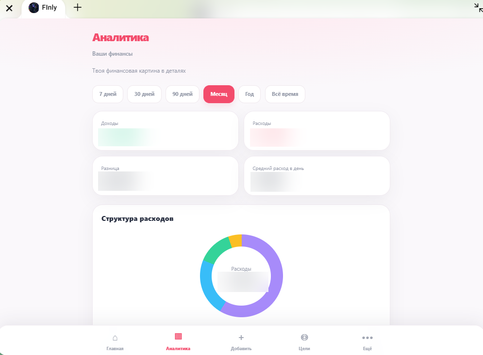
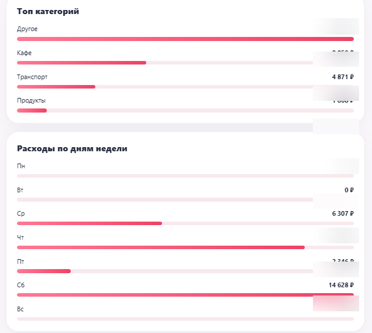
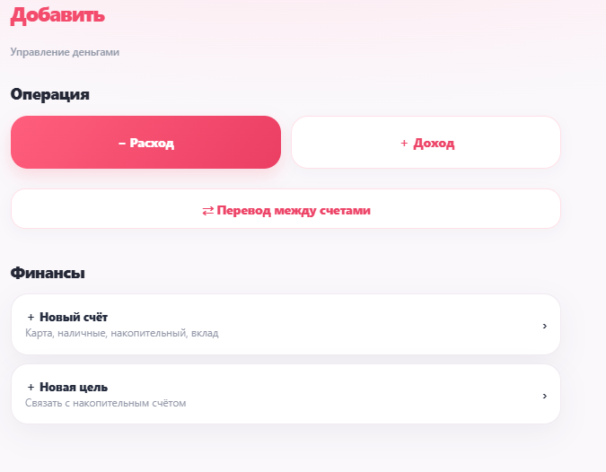
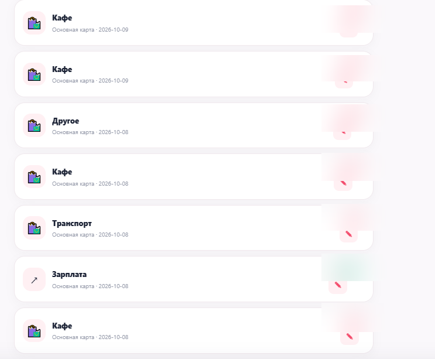

<div align="center">


### Финансовый помощник, который всегда под рукой

**Telegram-бот + Mini App для управления личными финансами**

[](https://www.python.org/)
[](https://fastapi.tiangolo.com/)
[](https://core.telegram.org/bots/webapps)
[](https://www.sqlite.org/)

</div>

## О проекте

**FINLY** — приложение для ежедневного контроля финансов прямо в Telegram. Оно объединяет привычный интерфейс бота с визуальной аналитикой в Telegram Mini App: помогает записывать операции, видеть остатки по счетам, планировать бюджет и двигаться к финансовым целям.

## Возможности

| | Функция | Что делает |
|:--:|---|---|
| 🏠 | **Главная** | Общий капитал, доступные средства, резерв, дневной лимит и последние операции |
| 📊 | **Аналитика** | Доходы, расходы, динамика и распределение по категориям |
| 💸 | **Операции** | Доходы, расходы, переводы между счетами и редактирование записей |
| 🎯 | **Цели** | Накопления и отслеживание прогресса |
| 🗓️ | **Планирование** | Предстоящие платежи и финансовые обязательства |
| 🤖 | **Telegram-бот** | Быстрое внесение операций через диалог и кнопки |

## Интерфейс

Реальные экраны FINLY. **Финансовые значения на скриншотах скрыты** для публичной демонстрации.

<table>
<tr><td width="50%" align="center"><b>Аналитика</b><br/></td><td width="50%" align="center"><b>Категории расходов</b><br/></td></tr>
<tr><td width="50%" align="center"><b>Добавление операций</b><br/></td><td width="50%" align="center"><b>История операций</b><br/></td></tr>
</table>

## Технологии

- **Backend:** Python, FastAPI, Uvicorn
- **Telegram:** aiogram 3, Telegram Mini Apps
- **Frontend:** HTML, CSS, JavaScript
- **Хранение данных:** SQLite
- **Развёртывание:** Linux, Nginx, HTTPS

## Быстрый старт

```bash
git clone https://github.com/toptyga88/FINLY.git
cd FINLY
python -m venv .venv
source .venv/bin/activate
pip install -r requirements.txt
cp .env.example .env
```

В `.env` укажи собственный `BOT_TOKEN`, созданный через BotFather. Для Mini App понадобится доступный по HTTPS адрес и настройка Telegram Web App. После настройки окружения API можно запускать командой:

```bash
uvicorn api:app --host 127.0.0.1 --port 8001
```

> Примечание: это стартовая инструкция для разработчика, а не готовый one-click деплой. Для публичного использования необходимо отдельно настроить HTTPS, домен, права доступа и хранение данных.

## Структура проекта

```text
FINLY/
├── api.py              # HTTP API и Telegram Mini App
├── main.py             # Telegram-бот
├── analytics.py        # Расчёты аналитики
├── database.py         # Работа с данными
├── config.py           # Переменные окружения
├── index.html          # Интерфейс Mini App
├── analytics-ui.js     # Аналитика на клиенте
├── static/             # Статические ресурсы
├── docs/               # Материалы README
├── requirements.txt    # Зависимости
└── .env.example        # Пример конфигурации
```

## Безопасность

- Не добавляй в Git `.env`, рабочую базу данных и резервные копии.
- Используй отдельный токен Telegram для собственного экземпляра.
- Не публикуй реальные финансовые данные и приватные адреса.
- Перед каждым публичным релизом проверяй изменения на наличие секретов.

## Планы развития

- [x] Учёт доходов и расходов
- [x] Несколько счетов и переводы
- [x] Аналитика и финансовые цели
- [x] Редактирование операций
- [ ] Расширенная история с поиском и фильтрами
- [ ] Экспорт отчётов
- [ ] Дополнительные инструменты планирования

---

<div align="center">

**FINLY — финансы под контролем.**

*Your money. Your rules.*

</div>
